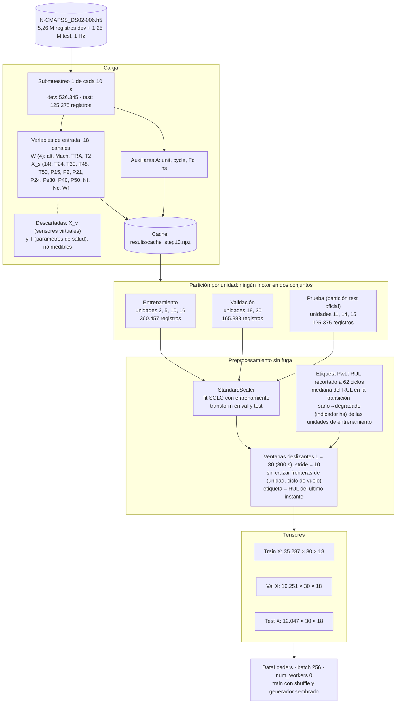
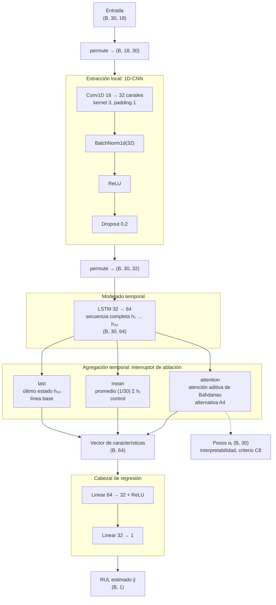
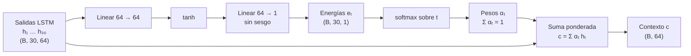
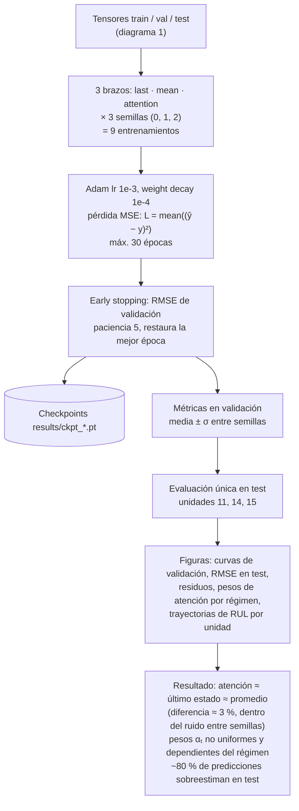

# Diagramas del pipeline y la arquitectura — RULv01 (N-CMAPSS DS02)

Ablación del mecanismo de atención temporal sobre una arquitectura híbrida
1D-CNN + LSTM. Las cifras provienen de las salidas de `RULv01.ipynb`.

---

## 1. Pipeline de datos

---

## 2. Arquitectura híbrida 1D-CNN + LSTM con tres modos de agregación

El parámetro `aggregation` es la **única** diferencia entre los tres brazos de la ablación.

| Brazo | Agregación | Parámetros | Qué aísla |
|---|---|---|---|
| `last` | último estado $h_T$ | 29.025 | Línea base |
| `mean` | promedio temporal | 29.025 | Efecto de agregar toda la ventana |
| `attention` | atención de Bahdanau | 33.249 (+4.224) | Efecto de la ponderación aprendida |

---

## 3. Detalle del módulo de atención temporal

$e_t = v^\top \tanh(W h_t + b)$, $\quad \alpha_t = \mathrm{softmax}(e_t)$, $\quad c = \sum_t \alpha_t h_t$

---

## 4. Protocolo experimental

### Métricas reportadas

- **RMSE** y **MAE**, en ciclos.
- **Score NASA** asimétrico normalizado por N: `exp(−d/13) − 1` si d < 0, `exp(d/10) − 1` si d ≥ 0, con d = ŷ − y.
- **Sesgo** y **% de sobreestimación**.
- **RMSE por tramo:** crítico (RUL ≤ 26), medio (26–52) y sano (> 52), a partir de los terciles de entrenamiento.
- **RMSE por unidad de prueba:** 11, 14 y 15.
