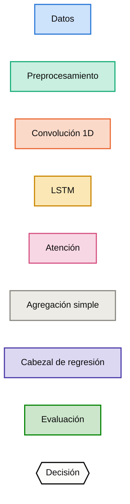
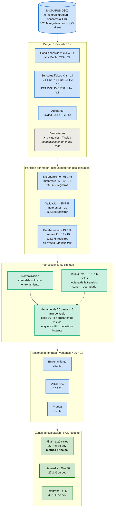
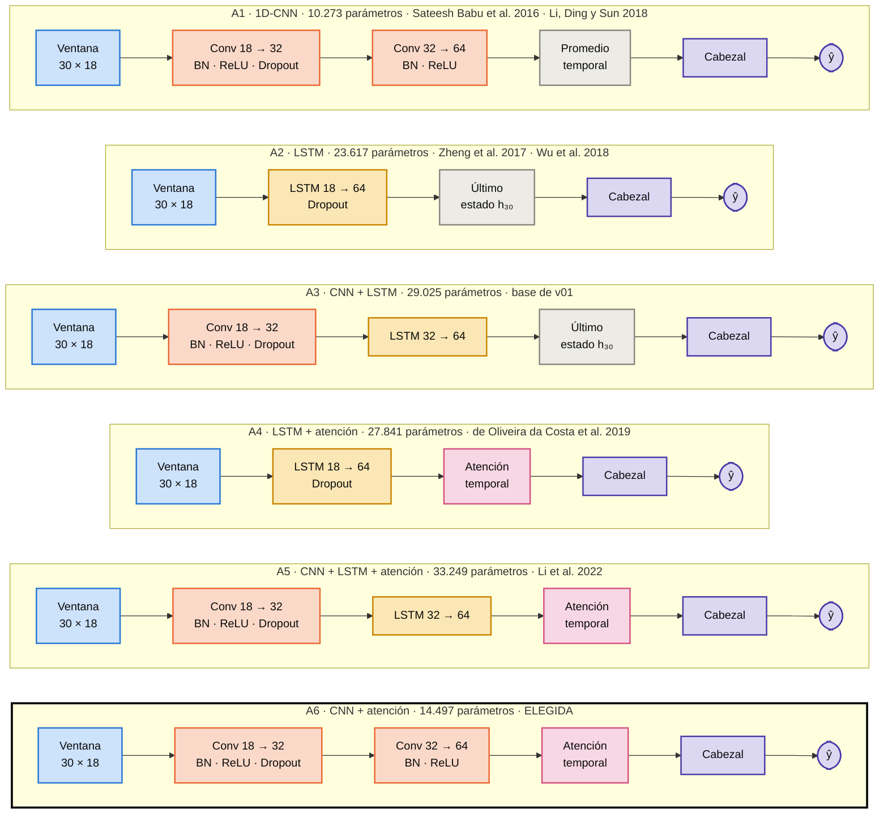
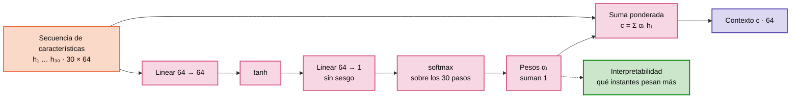
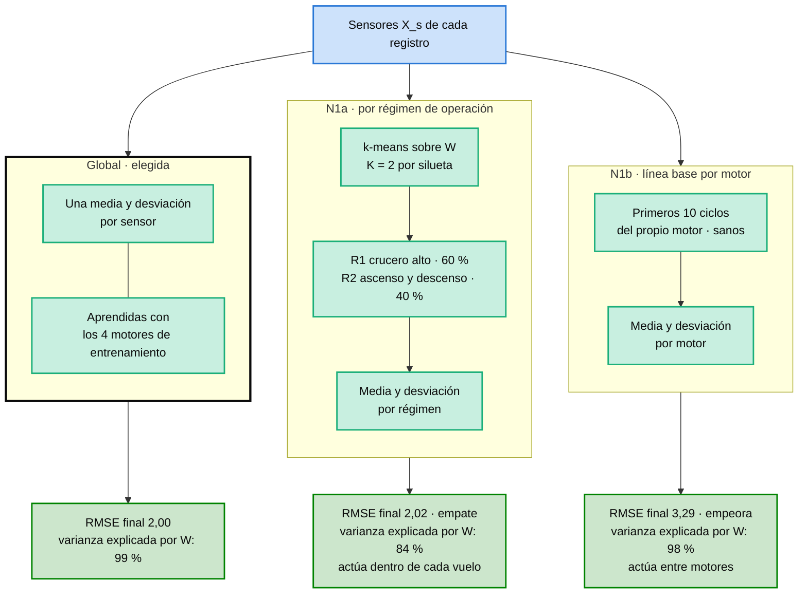
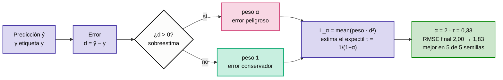
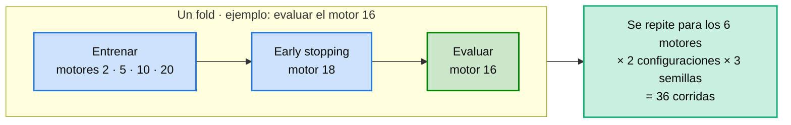
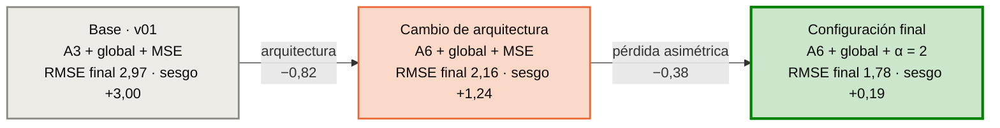

# Diagramas del pipeline y las arquitecturas — RULv02 (N-CMAPSS DS02)

Diagramas de `RULv02.ipynb`. Todas las cifras provienen de las salidas del notebook.

## Lenguaje visual

Cada tipo de bloque tiene un color fijo en todos los diagramas, para que la diferencia
entre arquitecturas se vea de un vistazo.

---

## 1. Visión general: un factor por etapa

Cada etapa cambia un solo factor y fija su elección para la siguiente. Los criterios de
selección se registraron antes de ver resultados (`results/seleccion.json`).

```mermaid
flowchart LR
    E0["Etapa 0<br/>Infraestructura común<br/><i>reproduce v01 con Δ = 0</i>"]:::prep
    E1["Etapa 1<br/>Ablación de arquitecturas<br/>A1 … A6 · 5 semillas"]:::conv
    D1{{"A6 · CNN + atención<br/>RMSE final 2,00"}}:::dec
    E2["Etapa 2<br/>Normalización<br/>global · N1a · N1b"]:::prep
    D2{{"Se mantiene la global<br/>N1a empata · N1b empeora"}}:::dec
    E3["Etapa 3<br/>Pérdida asimétrica<br/>α = 1, 2, 4"]:::head
    D3{{"α = 2<br/>mejor en 5 de 5 semillas"}}:::dec
    E4["Etapa 4<br/>Validación cruzada<br/>6 folds · 3 semillas"]:::evalc
    R["Prueba oficial · única evaluación<br/>RMSE final 1,78 frente a 2,97 de la base"]:::evalc

    E0 --> E1 --> D1 --> E2 --> D2 --> E3 --> D3 --> E4 --> R

    classDef prep fill:#c8efe0,stroke:#1baf7a,stroke-width:2px,color:#0b0b0b
    classDef conv fill:#fbd9c9,stroke:#eb6834,stroke-width:2px,color:#0b0b0b
    classDef head fill:#dcd8f2,stroke:#4a3aa7,stroke-width:2px,color:#0b0b0b
    classDef evalc fill:#cce6cc,stroke:#008300,stroke-width:2px,color:#0b0b0b
    classDef dec fill:#fcfcfb,stroke:#0b0b0b,stroke-width:2px,color:#0b0b0b
```

**Configuración final:** A6 (CNN + atención) · normalización global · pérdida asimétrica
con α = 2.

---

## 2. Pipeline de datos

---

## 3. Catálogo de arquitecturas (ablación de la etapa 1)

Todas reciben ventanas de 30 pasos × 18 canales y terminan en el mismo cabezal
(Linear 64 → 32 + ReLU → Linear 32 → 1). Comparten tamaños de bloque, pero no el
número de parámetros.

**Cómo leer la ablación:** cada par aísla un bloque.

| Par | Qué aísla | RMSE final en validación (mediana) |
|---|---|---|
| A1 → A6 | Atención sobre una CNN | 2,02 → 2,00 |
| A2 → A4 | Atención sobre una LSTM | 2,07 → 2,17 |
| A3 → A5 | Atención sobre CNN + LSTM | 2,60 → 2,18 |
| A1 → A3 | Agregar recurrencia a la CNN | 2,02 → 2,60 |

---

## 4. Módulo de atención temporal

$e_t = v^\top \tanh(W h_t + b)$, $\quad \alpha_t = \mathrm{softmax}(e_t)$, $\quad c = \sum_t \alpha_t h_t$

En A6 los pesos resultaron casi uniformes (≈ 1/30), con picos solo en los bordes de la
ventana: en la práctica, A6 se comporta como un promedio temporal.

---

## 5. Normalizaciones comparadas (etapa 2)

Las condiciones de vuelo W se estandarizan globalmente en los tres casos y siguen siendo
entrada del modelo. No se normaliza literalmente por la clase de vuelo `Fc` porque todo
`dev` es `Fc = 3`; las unidades de prueba 14 y 15 (`Fc` 1 y 2) quedarían sin
estadísticas.

---

## 6. Función de pérdida asimétrica (etapa 3)

| α | Expectil τ | Sobreestimar 5 ciclos cuesta lo mismo que subestimar |
|---|---|---|
| 1 (= MSE) | 0,50 | 5,0 ciclos |
| 2 · elegido | 0,33 | 7,1 ciclos |
| 4 | 0,20 | 10,0 ciclos |

---

## 7. Validación cruzada dejando un motor fuera (etapa 4)

Cada motor de `dev` se evalúa una vez. El siguiente de la lista se usa para el early
stopping y los 4 restantes para entrenar. La normalización se reaprende en cada fold.

| Fold | Evaluación | Validación | Entrenamiento |
|---|---|---|---|
| 1 | 2 | 5 | 10, 16, 18, 20 |
| 2 | 5 | 10 | 2, 16, 18, 20 |
| 3 | 10 | 16 | 2, 5, 18, 20 |
| 4 | 16 | 18 | 2, 5, 10, 20 |
| 5 | 18 | 20 | 2, 5, 10, 16 |
| 6 | 20 | 2 | 5, 10, 16, 18 |

---

## 8. Resultado final en el conjunto de prueba oficial

Mediana sobre 5 semillas; la peor semilla de la configuración final (1,97) es mejor que la
mejor de la base (2,47). En la validación cruzada la ventaja no es uniforme: depende de si
el modelo base es optimista o pesimista con cada motor.
