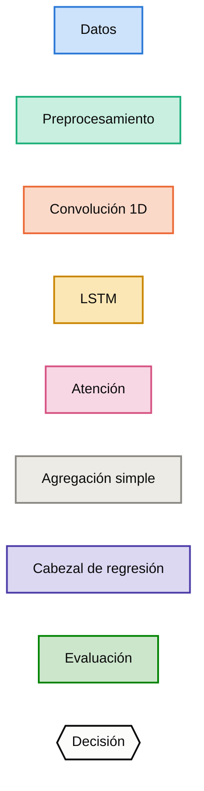
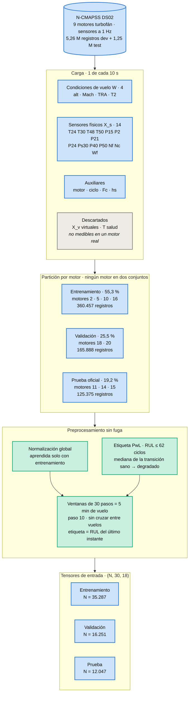
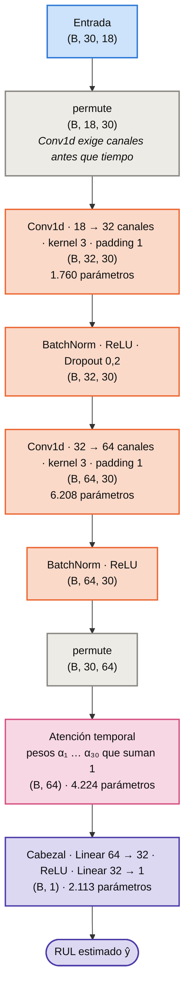
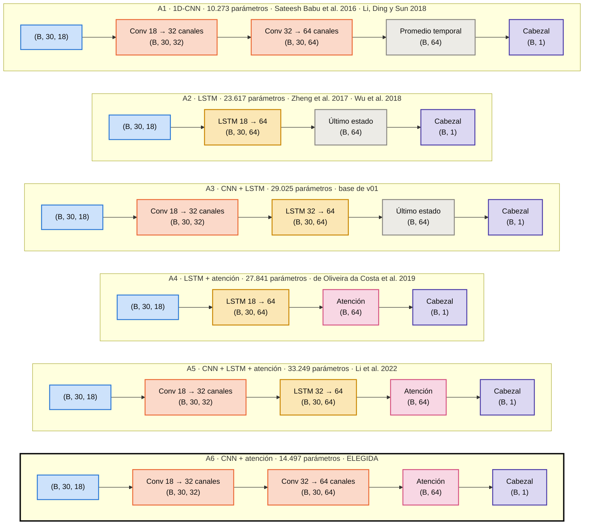
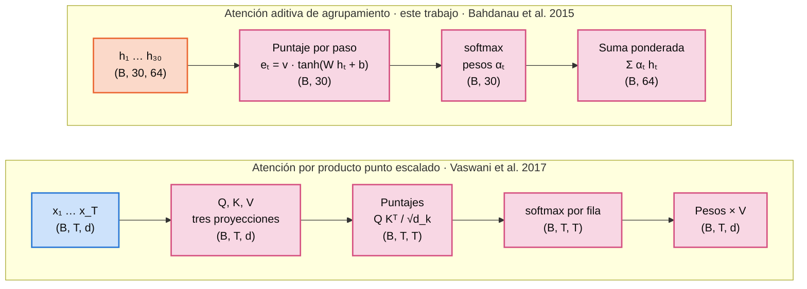
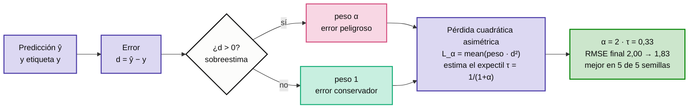
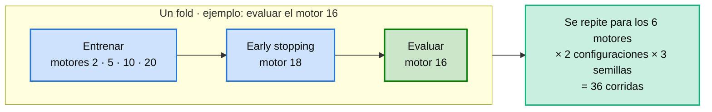
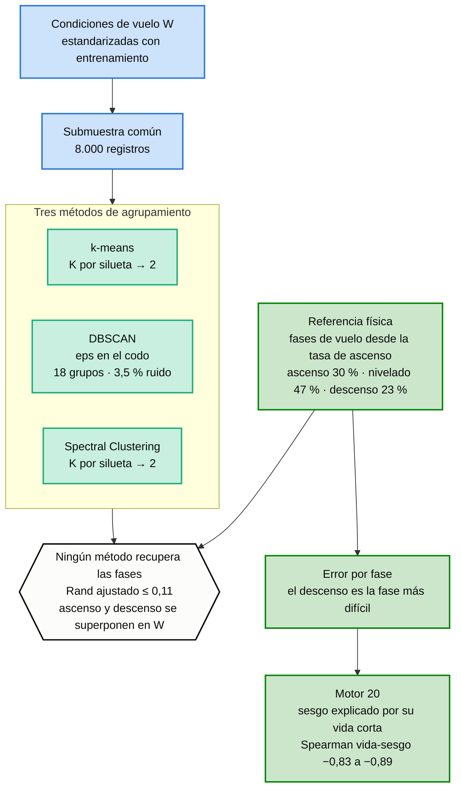
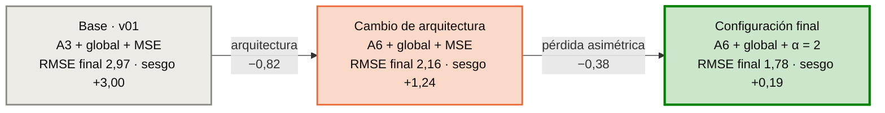

# Diagramas del pipeline y las arquitecturas — RULv03 (N-CMAPSS DS02)

Diagramas de `RULv03.ipynb`. Todas las cifras provienen de las salidas del notebook.

**Notación de formas:** `(B, T, C)` = (ventanas del lote, pasos de tiempo, canales). Con
B = 256 ventanas, T = 30 pasos (5 minutos de vuelo) y C el número de canales. Cada bloque de
las arquitecturas indica la forma del tensor a su salida, para que se vea qué dimensión
cambia: la temporal se mantiene siempre en 30 y solo cambian los canales.

## Lenguaje visual

Cada tipo de bloque tiene un color fijo en todos los diagramas.

---

## 1. Visión general de ProjectV03

```mermaid
flowchart LR
    E0["Etapa 0<br/>Infraestructura comentada<br/><i>reproduce v02 con diferencia 0</i>"]:::prep
    E1["Etapa 1<br/>Ablación A1 … A6<br/>curvas en eje común de 30 épocas"]:::conv
    D1{{"A6 · CNN + atención<br/>converge más lento"}}:::dec
    E2["Etapa 2<br/>Pérdida asimétrica<br/>α = 1, 2, 4 · referencias"]:::head
    D2{{"α = 2<br/>expectil τ = 0,33"}}:::dec
    E3["Etapa 3<br/>Validación cruzada<br/>y prueba oficial"]:::evalc
    E4["Etapa 4<br/>Doble clic: regímenes,<br/>error por fase, motor 20"]:::evalc
    E5["Etapa 5<br/>Documentación"]:::prep

    E0 --> E1 --> D1 --> E2 --> D2 --> E3 --> E4 --> E5

    classDef prep fill:#c8efe0,stroke:#1baf7a,stroke-width:2px,color:#0b0b0b
    classDef conv fill:#fbd9c9,stroke:#eb6834,stroke-width:2px,color:#0b0b0b
    classDef head fill:#dcd8f2,stroke:#4a3aa7,stroke-width:2px,color:#0b0b0b
    classDef evalc fill:#cce6cc,stroke:#008300,stroke-width:2px,color:#0b0b0b
    classDef dec fill:#fcfcfb,stroke:#0b0b0b,stroke-width:2px,color:#0b0b0b
```

**Configuración final:** A6 (CNN + atención) · normalización global · pérdida asimétrica con
α = 2. El entrenamiento es el de v02 (early stopping, paciencia 5, máximo 30 épocas), cuyas
corridas se reutilizan tras verificar que el código de v03 las reproduce exactamente.

---

## 2. Pipeline de datos

---

## 3. Arquitectura elegida (A6) con la forma de cada tensor

Total: 14.497 parámetros. En ninguna capa cambia la dimensión temporal (30): con kernel 3,
padding 1 y paso 1, la longitud de salida es (30 + 2 − 3) / 1 + 1 = 30. Las convoluciones
solo cambian el número de canales.

---

## 4. Catálogo de arquitecturas (ablación de la etapa 1)

Las formas se muestran como `(B, tiempo, canales)` para comparar las arquitecturas entre sí;
dentro de las convoluciones el tensor se reordena a `(B, canales, tiempo)`, como detalla el
diagrama 3.

**Pares que aíslan la atención** (difieren solo en la agregación):

| Par | RMSE final en validación (mediana) |
|---|---|
| A1 → A6 (CNN) | 2,02 → 2,00 |
| A2 → A4 (LSTM) | 2,07 → 2,17 |
| A3 → A5 (CNN + LSTM) | 2,60 → 2,18 |

Las comparaciones entre extractores (por ejemplo, A1 frente a A3) no son estrictas: cambian
el bloque, el número de convoluciones y la agregación a la vez.

---

## 5. Atención de este trabajo frente a la atención del Transformer

| | Este trabajo | Transformer |
|---|---|---|
| Consulta | Una sola, aprendida y fija | Una por paso, calculada desde la entrada |
| Resultado | Un vector que resume la ventana | Una secuencia transformada, del mismo largo |
| Pesos por ventana | 30 | T × T |

---

## 6. Función de pérdida asimétrica (etapa 2)

| α | Expectil τ | Cociente subestimación / sobreestimación: teórico · medido en validación |
|---|---|---|
| 1 (= MSE) | 0,50 | 1 · 1,05 |
| 2 · elegido | 0,33 | 2 · 1,75 |
| 4 | 0,20 | 4 · 3,53 |

Referencias: Newey y Powell (1987) para la regresión por expectiles; Efron (1991) para el
nombre de la pérdida.

---

## 7. Validación cruzada dejando un motor fuera (etapa 3)

---

## 8. Análisis "doble clic": regímenes de operación (etapa 4)

---

## 9. Resultado en el conjunto de prueba oficial

Mediana sobre 5 semillas. En la validación cruzada la ventaja no es uniforme: depende de si el
modelo base es optimista o pesimista con cada motor, lo que a su vez se relaciona con la vida
total del motor.
