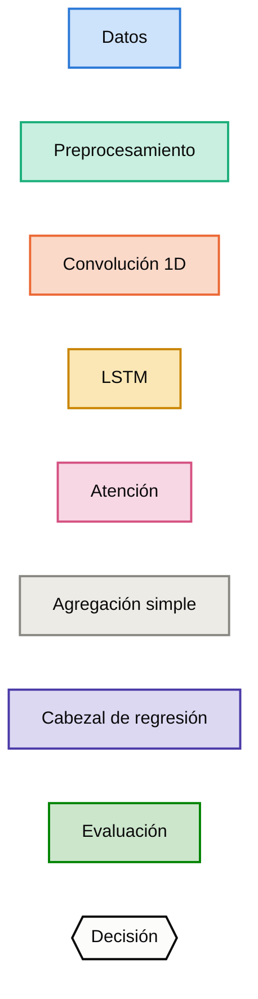
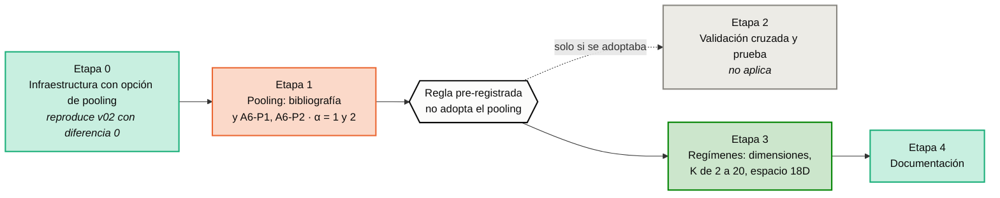
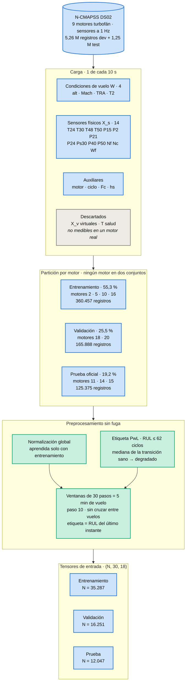
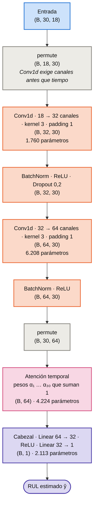
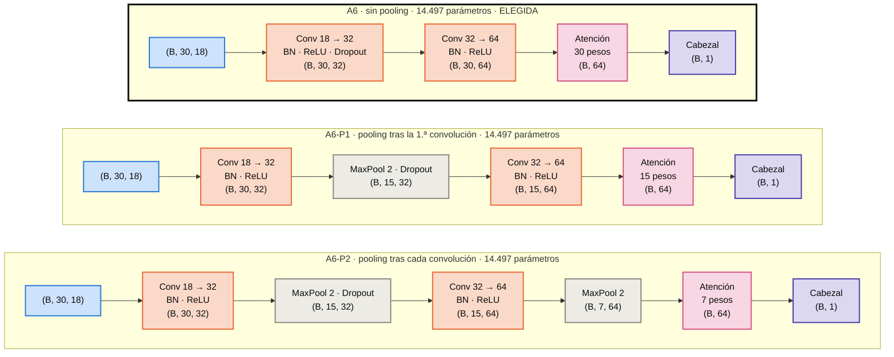
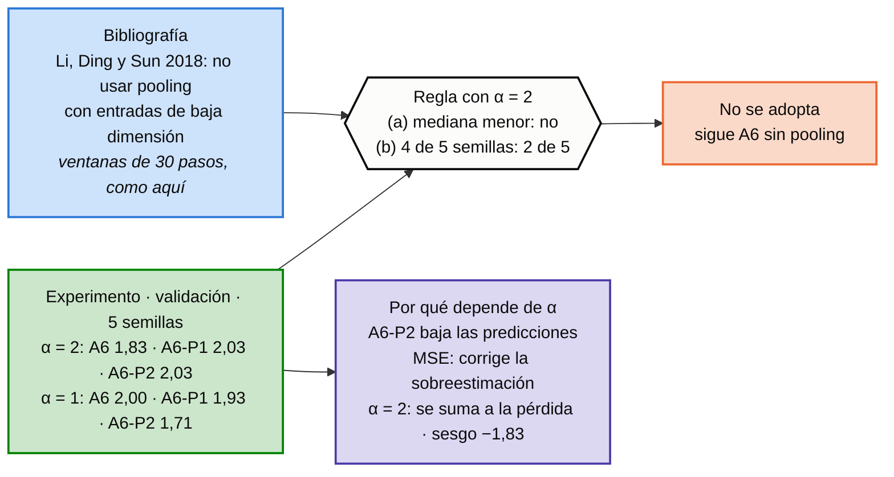
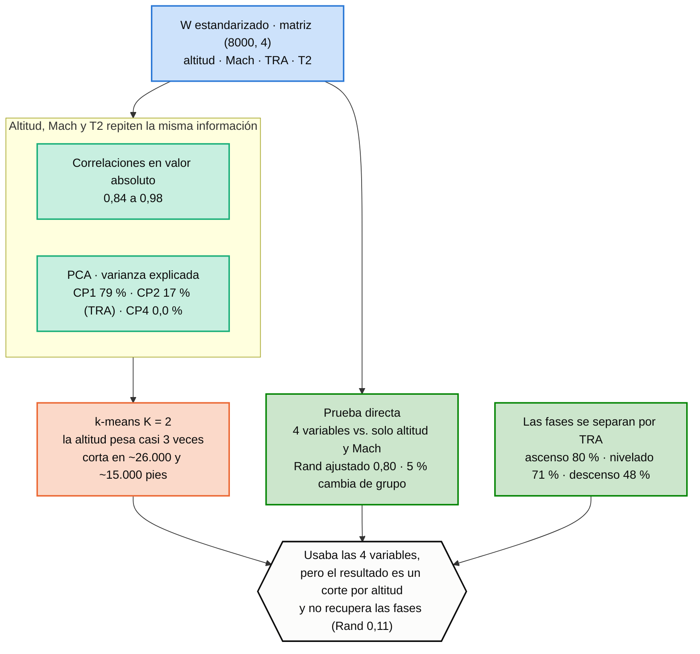
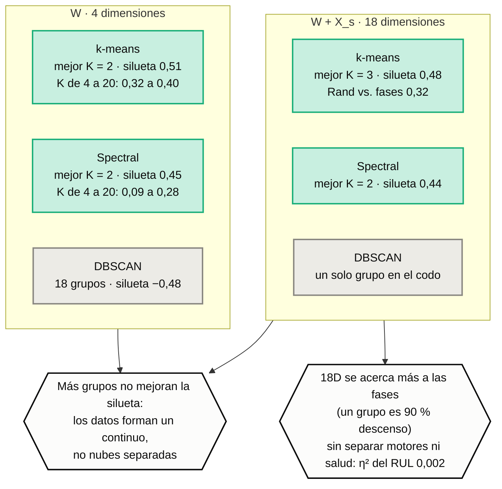
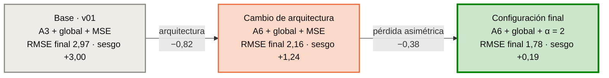

# Diagramas del pipeline y las arquitecturas — RULv04 (N-CMAPSS DS02)

Diagramas de `RULv04.ipynb`. Todas las cifras provienen de las salidas del notebook. Los
diagramas del catálogo de arquitecturas A1–A6, de la atención frente al Transformer, de la
pérdida asimétrica y de la validación cruzada no cambian y están en `ProjectV03/Diagramas.md`.

**Notación de formas:** `(B, T, C)` = (ventanas del lote, pasos de tiempo, canales). Con
B = 256 ventanas, T = 30 pasos (5 minutos de vuelo) y C el número de canales. Cada bloque de
las arquitecturas indica la forma del tensor a su salida, para que se vea qué dimensión
cambia: sin pooling, la temporal se mantiene en 30 y solo cambian los canales; con pooling
(diagrama 4), el tiempo se reduce a 15 o 7.

## Lenguaje visual

Cada tipo de bloque tiene un color fijo en todos los diagramas.

---

## 1. Visión general de ProjectV04

**Configuración final (sin cambios respecto de v03):** A6 (CNN + atención) · normalización
global · pérdida asimétrica con α = 2. El conjunto de prueba no se volvió a usar en v04.

---

## 2. Pipeline de datos

---

## 3. Arquitectura elegida (A6, sin pooling) con la forma de cada tensor

Total: 14.497 parámetros. En ninguna capa cambia la dimensión temporal (30): con kernel 3,
padding 1 y paso 1, la longitud de salida es (30 + 2 − 3) / 1 + 1 = 30. Las convoluciones
solo cambian el número de canales.

---

## 4. A6 con y sin pooling, con la forma de cada tensor (etapa 1)

El max pooling de tamaño 2 deja el mayor de cada par de pasos: divide el tiempo por 2,
redondeando hacia abajo (15 // 2 = 7), y no cambia los canales ni agrega parámetros. Con la
misma semilla, las tres variantes parten de los mismos pesos.

---

## 5. Resultado del pooling y decisión (etapa 1)

RMSE en la zona final (RUL ≤ 20), mediana sobre 5 semillas.

---

## 6. ¿El clustering usaba 4 dimensiones o 2? (etapa 3)

---

## 7. Más grupos y dos espacios de agrupamiento (etapa 3)

Escala orientativa de la silueta (Kaufman y Rousseeuw, 1990): sobre 0,70, estructura
fuerte; de 0,51 a 0,70, razonable; de 0,26 a 0,50, débil; bajo 0,25, sin estructura
sustancial.

---

## 8. Resultado en el conjunto de prueba oficial (v03, sin cambios en v04)

Mediana sobre 5 semillas. Evaluado una sola vez en v02 y presentado de nuevo en v03; v04
no modificó la configuración final ni volvió a usar el conjunto de prueba. En la validación cruzada la ventaja no es uniforme: depende de si el
modelo base es optimista o pesimista con cada motor, lo que a su vez se relaciona con la vida
total del motor.
