# Diagramas del pipeline y las arquitecturas — RULv05 (N-CMAPSS DS02)

Diagramas de `RULv05.ipynb`. Todas las cifras provienen de las salidas del notebook y son de
validación (motores 18 y 20), salvo el diagrama 9, que es la prueba oficial de v03. Los
diagramas del catálogo de arquitecturas A1–A6, de la atención frente al Transformer, de la
pérdida asimétrica y de la validación cruzada están en `ProjectV03/Diagramas.md`; los del
agrupamiento de regímenes de operación, en `ProjectV04/Diagramas.md`.

**Notación de formas:** `(B, T, C)` = (ventanas del lote, pasos de tiempo, canales). Con
B = 256 ventanas, T = 30 pasos (5 minutos de vuelo) y C el número de canales. Cada bloque de
las arquitecturas indica la forma del tensor a su salida, para que se vea qué dimensión
cambia: sin pooling, la temporal se mantiene en 30 y solo cambian los canales; con pooling
(diagramas 4 y 5), el tiempo se reduce a 15 o 7.

## Lenguaje visual

Cada tipo de bloque tiene un color fijo en todos los diagramas.

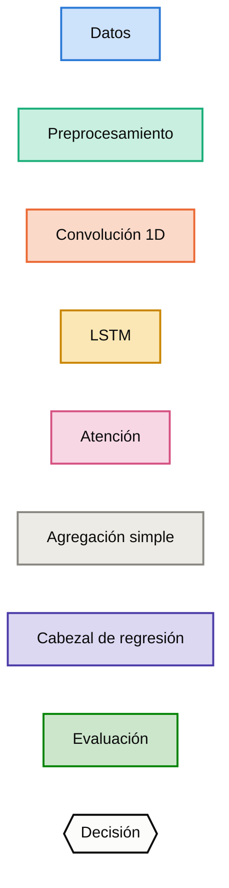

---

## 1. Visión general de ProjectV05

```mermaid
flowchart LR
    R6["Reunión 06<br/>score, sesgo global,<br/>dropout y pooling"]:::datos
    E0["Etapa 0<br/>Infraestructura y métricas nuevas<br/><i>reproduce v02 y v04 con diferencia 0</i>"]:::prep
    E1["Etapa 1<br/>El sesgo: qué es y cuánto<br/>se sobreestima o subestima"]:::evalc
    E2["Etapa 2<br/>El score NASA:<br/>por qué es tan bajo"]:::evalc
    E3["Etapa 3<br/>Por qué el sesgo global<br/>y correcciones de v04"]:::head
    E4["Etapa 4<br/>Documentación y GitHub"]:::prep

    R6 --> E0 --> E1 --> E2 --> E3 --> E4

    classDef datos fill:#cde2fb,stroke:#2a78d6,stroke-width:2px,color:#0b0b0b
    classDef prep fill:#c8efe0,stroke:#1baf7a,stroke-width:2px,color:#0b0b0b
    classDef conv fill:#fbd9c9,stroke:#eb6834,stroke-width:2px,color:#0b0b0b
    classDef lstm fill:#fbe7b5,stroke:#c98500,stroke-width:2px,color:#0b0b0b
    classDef att fill:#f8d7e4,stroke:#d55181,stroke-width:2px,color:#0b0b0b
    classDef agg fill:#ecebe6,stroke:#898781,stroke-width:2px,color:#0b0b0b
    classDef head fill:#dcd8f2,stroke:#4a3aa7,stroke-width:2px,color:#0b0b0b
    classDef evalc fill:#cce6cc,stroke:#008300,stroke-width:2px,color:#0b0b0b
    classDef dec fill:#fcfcfb,stroke:#0b0b0b,stroke-width:2px,color:#0b0b0b
```

**Versión de análisis:** no hay experimentos nuevos ni cambia la configuración final, que
sigue siendo A6 (CNN + atención) · normalización global · pérdida asimétrica con α = 2. Se
reanalizan las predicciones guardadas de v02 y v04, y el conjunto de prueba no se consulta.

---

## 2. Pipeline de datos

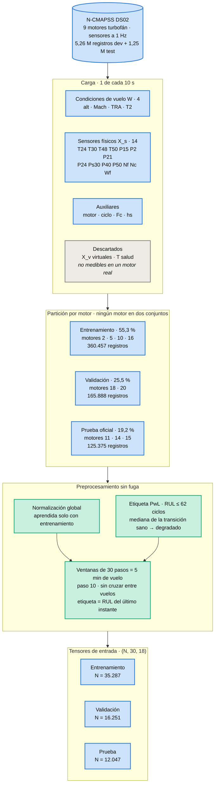

---

## 3. Arquitectura elegida (A6, sin pooling) con la forma de cada tensor

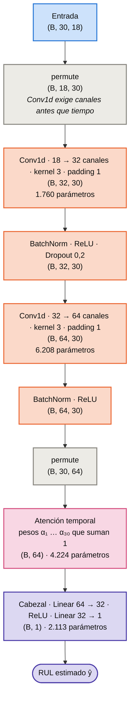

Total: 14.497 parámetros. En ninguna capa cambia la dimensión temporal (30): con kernel 3,
padding 1 y paso 1, la longitud de salida es (30 + 2 − 3) / 1 + 1 = 30. Las convoluciones
solo cambian el número de canales.

---

## 4. A6 con y sin pooling, con la forma de cada tensor (v04, etapa 1)

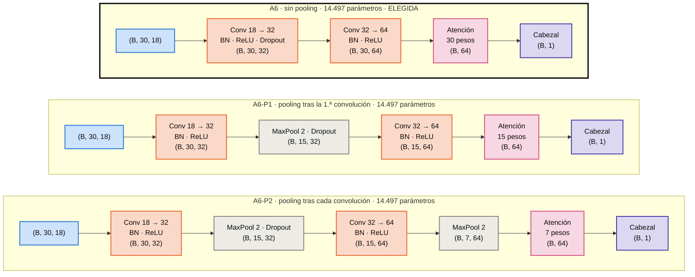

El max pooling de tamaño 2 deja el mayor de cada par de pasos: divide el tiempo por 2,
redondeando hacia abajo (15 // 2 = 7), y no cambia los canales ni agrega parámetros. Con la
misma semilla, las tres variantes parten de los mismos pesos.

---

## 5. Orden real de las capas y origen del único dropout (etapa 3)

Orden comprobado en v05 recorriendo la red con *hooks* de PyTorch (sección 3.4). El dropout
va **después** del max pooling. Formas en la notación de Conv1d, `(B, canales, tiempo)`.

```mermaid
flowchart LR
    subgraph P2["A6-P2 · orden de ejecución"]
        direction LR
        c1["1 · Conv1d<br/>(B, 32, 30)"]:::conv --> b1["2 · BatchNorm<br/>(B, 32, 30)"]:::conv --> r1["3 · ReLU<br/>(B, 32, 30)"]:::conv --> m1["4 · MaxPool<br/>(B, 32, 15)<br/><i>cambia el tiempo</i>"]:::agg --> d1["5 · Dropout<br/>(B, 32, 15)"]:::agg --> c2["6 · Conv1d<br/>(B, 64, 15)<br/><i>cambia los canales</i>"]:::conv --> b2["7 · BatchNorm · 8 · ReLU<br/>(B, 64, 15)"]:::conv --> m2["9 · MaxPool<br/>(B, 64, 7)"]:::agg
    end

    classDef datos fill:#cde2fb,stroke:#2a78d6,stroke-width:2px,color:#0b0b0b
    classDef prep fill:#c8efe0,stroke:#1baf7a,stroke-width:2px,color:#0b0b0b
    classDef conv fill:#fbd9c9,stroke:#eb6834,stroke-width:2px,color:#0b0b0b
    classDef lstm fill:#fbe7b5,stroke:#c98500,stroke-width:2px,color:#0b0b0b
    classDef att fill:#f8d7e4,stroke:#d55181,stroke-width:2px,color:#0b0b0b
    classDef agg fill:#ecebe6,stroke:#898781,stroke-width:2px,color:#0b0b0b
    classDef head fill:#dcd8f2,stroke:#4a3aa7,stroke-width:2px,color:#0b0b0b
    classDef evalc fill:#cce6cc,stroke:#008300,stroke-width:2px,color:#0b0b0b
    classDef dec fill:#fcfcfb,stroke:#0b0b0b,stroke-width:2px,color:#0b0b0b
```

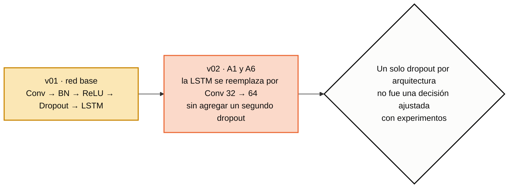

En A2 y A4, que no tienen convolución, el único dropout va después de la LSTM.

---

## 6. Resultado del pooling y decisión (v04, etapa 1; explicación corregida en v05)

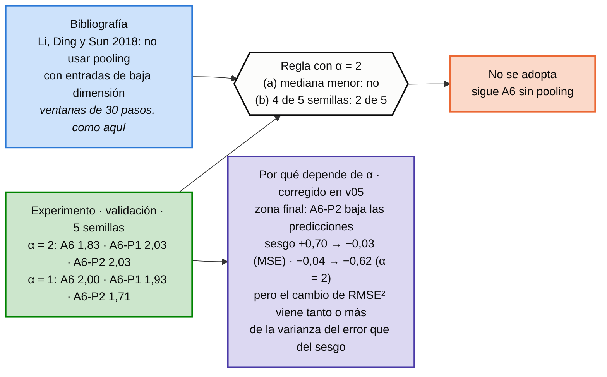

RMSE en la zona final (RUL ≤ 20), mediana sobre 5 semillas. v04 explicaba la dependencia de α con el
sesgo global (−1,32 y −1,83), que exageraba el efecto; la explicación corregida está en
`RULv05.ipynb`, etapa 3.

---

## 7. Descomposición del sesgo (etapa 1)

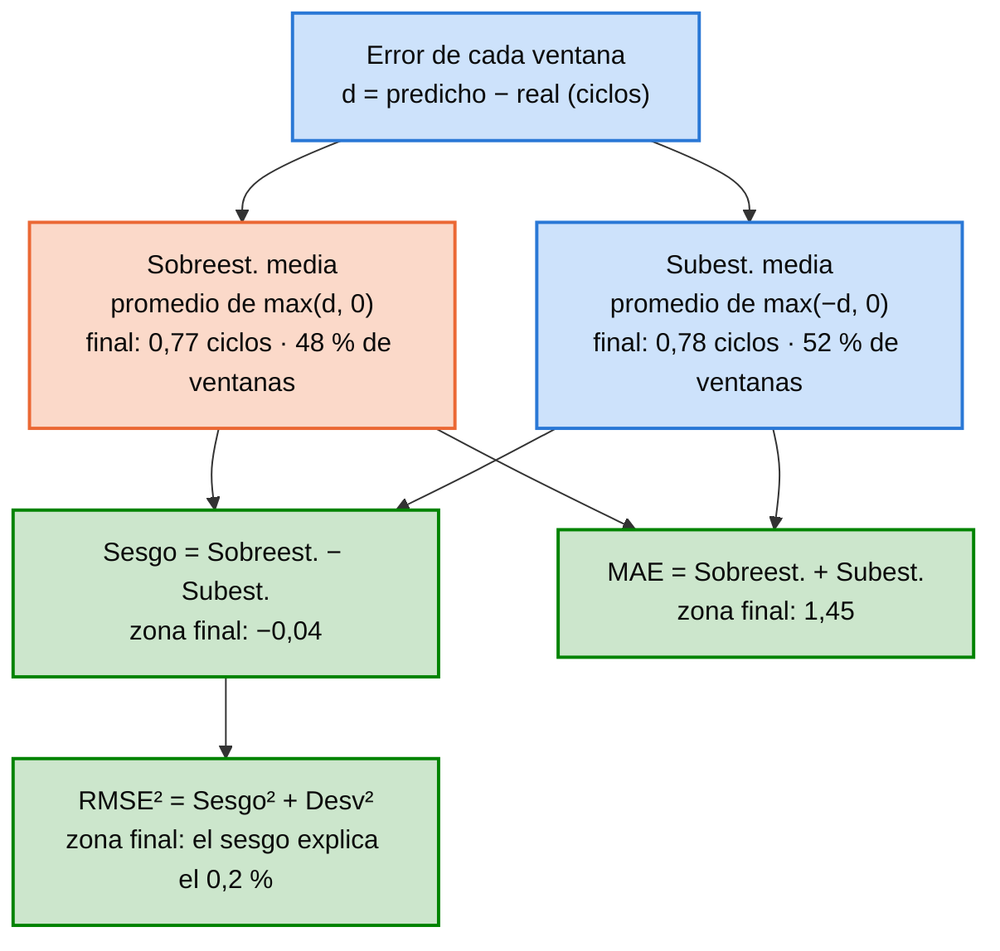

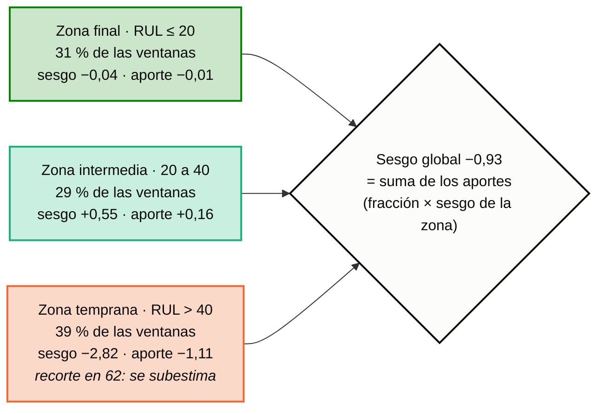

Configuración final (A6, α = 2), mediana sobre 5 semillas. Las medianas de los aportes no
suman exactamente la mediana del global; la suma es exacta en cada semilla. Por motor, el
sesgo final de −0,04 es el promedio del motor 18 (−1,04) y el 20 (+1,07).

---

## 8. Por qué el score NASA es tan bajo (etapa 2)

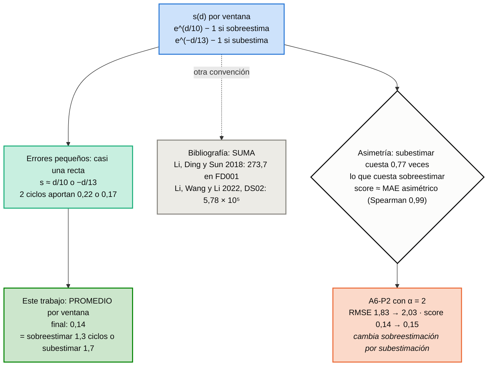

El score va de 0 a ∞; no tiene un máximo de 100. Con la suma, las predicciones de este
trabajo darían unos 700 en la zona final: los valores no son comparables con los publicados.

---

## 9. Resultado en el conjunto de prueba oficial (v03, sin cambios en v04 ni v05)

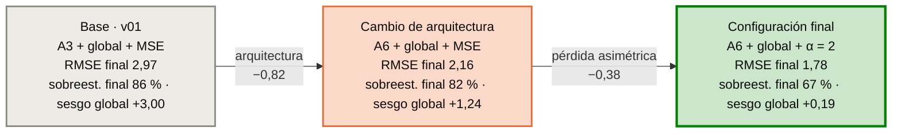

Mediana sobre 5 semillas. Evaluado una sola vez en v02 y presentado de nuevo en v03; v04 y
v05 no modificaron la configuración final ni volvieron a usar el conjunto de prueba. El
sesgo es el **global** (todas las ventanas de prueba), no el de la zona final; el porcentaje
de ventanas sobreestimadas sí es de la zona final, y su 67 % es, muy probablemente, el "67
sobre 100" mencionado en la Reunión 06. En la validación cruzada la ventaja no es uniforme: depende de si el
modelo base es optimista o pesimista con cada motor, lo que a su vez se relaciona con la vida
total del motor.
